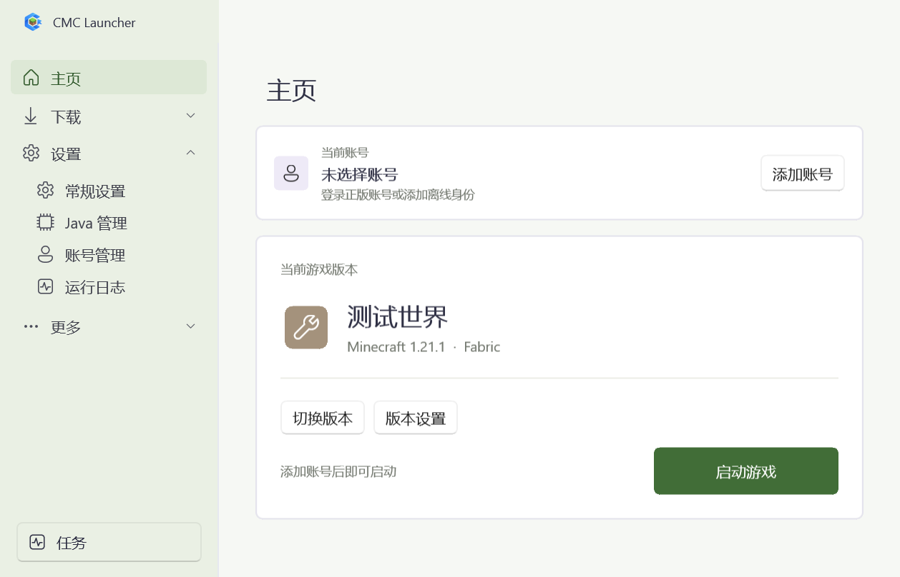

# CMCLauncher

<div align="center">

[English](README.md) · 简体中文

</div>

一款用于 Minecraft Java 版的 Windows 原生启动器，基于 C#、.NET 8 与 WinUI 3 构建。支持管理隔离实例、下载游戏版本与加载器、安装 Modrinth 内容，以及管理 Java 与账号。

当前版本：**0.9.4** · 平台：**Windows x64**

[下载](https://github.com/com-in/CMCLauncher/releases) · [官网](https://cmcl.ctfun.top/) · [反馈问题](https://github.com/com-in/CMCLauncher/issues)



## 快速开始

1. 从 [Releases](https://github.com/com-in/CMCLauncher/releases) 下载 `CMCLauncher-0.9.4-win-x64.zip`，解压整个压缩包，并运行 `CMCLauncher.exe`。
2. 打开 **设置 → Java**，扫描或导入已有的 Java 安装，或下载 Temurin Java。
3. 打开 **设置 → 账号**，选择 Microsoft 设备代码登录。在浏览器中完成授权，然后等待启动器验证你的 Minecraft Java 档案。
4. 下载游戏版本、导入已有的 `.minecraft` 文件夹，或导入整合包。在主界面选择版本与账号，然后启动。

发布压缩包已包含 .NET 与 Windows App SDK 运行时，因此你无需单独安装 .NET。Java 与游戏文件需另行下载或导入。更新由用户手动触发。

### 运行要求

- Windows 10 2004 版本（内部版本 19041）或更高版本，x64。
- 所选 Minecraft 版本所需的兼容 Java 运行时。启动器会在启动时检查并匹配已发现的 Java 安装。
- 用于 Microsoft 登录、且包含 Minecraft Java 版档案的 Microsoft 账号。在离线身份可用之前，至少需有一个 Microsoft 账号通过验证。

## 功能特性

| 领域 | 支持的功能 |
| --- | --- |
| 游戏与实例 | 浏览正式版、快照版与愚人节版本；创建隔离实例；导入本地游戏文件夹 |
| 加载器 | 查询并安装 Fabric、Forge 与 NeoForge；识别导入版本所使用的加载器 |
| 整合包 | 导入 Modrinth `.mrpack` 文件、包含受支持清单的 ZIP 压缩包，以及 MultiMC / Prism 的 ZIP 导出；支持拖拽导入 |
| 社区内容 | 浏览分页的 Modrinth 排行榜与搜索结果；查看项目版本，并核对游戏、加载器与安装目标的兼容性 |
| 内容管理 | 查看 Mod 元数据与图标；导入、禁用或移除内容；按世界管理数据包 |
| 结构蓝图 | 搜索、导入、导出、重命名与删除 `.litematic`、`.schematic`、`.schem` 与 `.nbt` 文件，包括嵌套文件夹 |
| Java 与内存 | 扫描、导入并下载 Temurin Java；自动匹配 Java 版本；采用自动或手动堆内存分配 |
| 下载 | 查看进度与速度、取消任务，并将同时下载文件数配置为 1–256（默认：16） |
| 外观与语言 | 浅色、深色与跟随系统主题；颜色、字体、缩放与外观预设；启动器与游戏的语言设置 |
| 账号与诊断 | Microsoft 设备代码登录、Windows DPAPI 凭据加密、运行时日志，以及游戏错误报告导出 |

新建实例会保持 Mod、存档与设置相互独立。导入的游戏保留其原始位置，包括被识别的版本隔离目录结构。

已完成任务会在窗口底部中央显示一条临时提示（toast）。已取消与失败的任务会在此处显示各自的结果。删除操作会在按钮旁弹出确认气泡；关闭气泡后文件保持不变。

结构蓝图页面会在含 `schematics` 文件夹的模组实例的版本设置中出现。若该文件夹不存在，启动器会检查已启用 Mod 的元数据，识别受支持的 Litematica/Schematica 移植或 Create 模组，并在检测到时创建该文件夹。原版实例会隐藏此页面。文件管理会保留原始格式；某个结构蓝图的兼容性仍由所安装的 Mod 负责。

结构蓝图子文件夹会作为可展开的目录显示，包括空文件夹。搜索会自动展开匹配的路径。在运行时日志页面开启 **DEBUG 模式**，可查看 HTTP 请求状态与响应头耗时、页面切换、任务耗时、传输次数与异常堆栈。该设置会在重启后保留；关闭后将不再产生新的 DEBUG 事件。HTTP 诊断会省略查询字符串、请求头与响应体。

社区资源页面将筛选器置于搜索框上方。可按游戏版本、适用的 Mod 或光影加载器，以及资源分类进行筛选；资源包另提供特性与分辨率筛选，光影另提供特性与性能影响筛选。「更多筛选」按钮会在右侧打开一个抽屉，其中包含按组分类的环境、来源可用性、许可证、作者、项目详情、数量、日期与内容披露选项。「应用筛选」会从第一页更新结果；「重置」仅清除抽屉中的选项。关闭抽屉会保留你的输入。使用「搜索」或回车提交，或使用「重置筛选」。已提交的筛选在翻页以及从项目详情返回后仍然生效。游戏版本列表默认显示正式版。开启「显示快照」或「显示愚人节版本」可在下拉框中显示对应版本；这两个开关相互独立。选择一个版本并提交搜索即可筛选资源。

## 支持范围与限制

- Forge 与 NeoForge 的安装可用，但安装与运行时兼容性尚未在所有游戏版本上充分验证。
- ZIP 只是一种容器格式，并非整合包格式。压缩包必须包含受支持的 Modrinth 或 MultiMC / Prism 清单。暂不支持 CurseForge 整合包的导入与文件下载。
- 提供用于未来集成的[保留 CurseForge API 接口](docs/CURSEFORGE.md)。该接口默认禁用，需在获得应用审批与授权凭据后方可启用。
- 光影需要已安装并启用的 Iris、Oculus 或 OptiFine 环境。导入后请在游戏内确认数据包已启用。
- 浏览器授权之后还需经过 Xbox 与 Minecraft 服务验证。实际的登录与进入游戏内菜单需要有效的应用配置与真实账号；本地测试无法替代端到端验证。
- 构建与验证目标为 Windows x64。未选用 ARM 原生依赖。

## 数据与日志

| 位置 | 内容 |
| --- | --- |
| `%APPDATA%/CMCLauncher.Native/settings.json` | 启动器设置、实例记录与加密的账号凭据 |
| `%APPDATA%/CMCLauncher.Native/library/` | 默认实例与依赖库；可在启动器中选择不同的游戏根目录 |
| `%APPDATA%/CMCLauncher.Native/runtimes/` | 由启动器下载的 Java 安装 |
| 可执行文件旁的 `logs/launcher-yyyyMMdd.log` | 启动器运行时日志 |
| 实例内的 `logs/` 与 `crash-reports/` | 游戏日志与崩溃报告 |

当新的数据目录尚不存在时，已有安装会继续沿用 `%APPDATA%/CraftLauncher.Native/`，从而保留账号、设置与实例路径。

凭据会使用 DPAPI 为当前 Windows 用户加密。将配置复制到其他用户或设备时，可能需要重新登录。备份游戏时，请一并包含其实际实例目录中的存档与设置。

即便启用了 SSL 错误覆盖，启动器的 HTTPS 客户端仍会拒绝其内嵌拒绝列表中的证书公钥。详见 [CertificatePolicy.cs](native/CertificatePolicy.cs)。该策略不会修改 Windows 信任存储，也不会更改外部 Java 安装程序与游戏所执行的证书验证。

## 从源码运行

在 Windows 上，安装 .NET 8 SDK 以及构建 WinUI 3 项目所需的 Windows SDK / 开发工具。项目目标框架为 `net8.0-windows10.0.19041.0`，架构为 x64。克隆仓库后，在仓库根目录运行以下命令：

```powershell
git clone https://github.com/com-in/CMCLauncher.git
cd CMCLauncher
dotnet run --project winui/CMCLauncher.WinUI.csproj -p:Platform=x64
```

如需一键本地构建，可双击仓库根目录中的 `build-and-run.cmd`。它会将自包含 Release 构建发布到 `.artifacts/local-runs/` 下的新文件夹，并打开该构建以供手动测试。它不会改动 `dist`，并保持控制台开启以便查看构建错误。每次运行都会保留各自的输出文件夹；关闭这些构建后可删除旧文件夹。应用程序会使用你惯常的启动器设置。

若要在不打开应用的情况下构建，可在 PowerShell 中运行 `./build-and-run.ps1 -NoLaunch`。

### 配置 Microsoft 登录

缺少 client ID 的源码构建可运行界面，但 Microsoft 登录不可用。若要在本地构建中启用，请创建 `winui/clientid.local.json` 并填入你已配置的公开 OAuth client ID：

```json
{
  "clientId": "YOUR_MICROSOFT_CLIENT_ID"
}
```

将占位符替换为有效的 GUID。该文件被 Git 忽略，并在编译时作为程序集资源嵌入；不会以独立 JSON 文件形式分发。client ID 是公开标识符，并非客户端密钥。你的应用仍需要相应的 Microsoft / Minecraft API 访问配置。启动器不会收集 Microsoft 密码。

打标签的 Release 构建会从 `MICROSOFT_CLIENT_ID` 这个 GitHub Actions 密钥中读取该标识符。普通 PR 构建不会写入它。

### 构建与打包

构建 Release 配置：

```powershell
dotnet build winui/CMCLauncher.WinUI.csproj -c Release -p:Platform=x64
```

发布自包含目录并创建 ZIP 压缩包：

```powershell
dotnet publish winui/CMCLauncher.WinUI.csproj -c Release -p:Platform=x64 -r win-x64 --self-contained true -o dist/cmc-launcher
./scripts/package-release.ps1 -PublishDirectory dist/cmc-launcher -ArchivePath dist/CMCLauncher-0.9.4-win-x64.zip
```

打包脚本会排除本地配置、凭据与密钥文件，然后检查压缩包中是否包含启动器可执行文件。

### 测试

运行原生回归测试：

```powershell
dotnet run --project native.tests/CMCLauncher.Tests.csproj -c Release
```

这些测试使用 Windows DPAPI，必须在 Windows 上运行。最后一项本地 Java 检测检查还需要 PATH 中存在 `java`。

发布应用目录后，运行 WinUI 集成检查：

```powershell
& ./dist/cmc-launcher/CMCLauncher.exe --verify-ui "$PWD/.artifacts/winui-check"
```

该检查使用隔离的数据目录，并生成截图与 `passed.txt`。失败会记录在 `failure.txt` 中。

## 源码结构

| 目录 | 内容 |
| --- | --- |
| [`winui/`](winui/) | 桌面入口、窗口、页面、控件与 UI 服务 |
| [`native/`](native/) | 下载、启动参数、认证、Java、内容管理与存储 |
| [`native.tests/`](native.tests/) | 原生回归测试与证书夹具 |
| [`scripts/`](scripts/) | 发布、资源整理与打包脚本 |
| [`docs/`](docs/) | 项目官网源码与截图资源 |
| [`.github/workflows/`](.github/workflows/) | 自动化测试、构建与打标签发布 |

## 反馈与贡献

通过 [Issues](https://github.com/com-in/CMCLauncher/issues) 反馈问题。请附上启动器版本、Windows 版本、Minecraft 与加载器版本，以及复现步骤。对于启动失败，请附上错误报告或相关日志。分享前请检查是否包含账号信息与本地路径。

提交 Pull Request 前，请运行与你改动相关的测试。布局改动请附上截图，并在修改下载、安装或导入功能时检查取消与失败后的清理情况。

## 许可证

CMCLauncher 基于 [GNU 通用公共许可证 v3.0](LICENSE) 发布。第三方依赖保留各自的许可证。

Minecraft、Mod 与整合包归各自所有者所有。CMCLauncher 与 Mojang Studios、Microsoft 或 NetEase 无任何关联。
